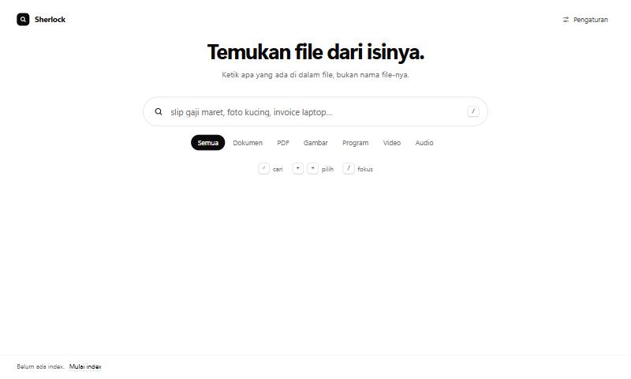

# Sherlock

A small Windows app that lets you find files on your PC by describing what's in them ("payslip for March", "photo of a cat"), powered by Google's multimodal Gemini Embedding 2.



Sherlock indexes a folder once, stores the embeddings locally, and then searches by meaning instead of by file name. Images are embedded as images, so a search for "diagram" finds a picture of a diagram even if the file is called `IMG_2041.png`.

- **Single `.exe`, about 18 MB.** It's written in Go with a native WebView2 window, and PDFium (Chrome's PDF engine) is built in as WebAssembly, so you don't need to install a runtime.
- **Multimodal.** Images are embedded as images. PDFs are embedded as an image of page 1 only, so scanned PDFs are found too and the vector isn't diluted by long text (their text is used only if page 1 can't be rendered). Word, Excel, PowerPoint, CSV and text files are embedded by their text. Programs, video and audio are embedded by their name and folder.
- **Page-1 previews.** Results show a thumbnail of the image or of the first page of a PDF. Word, Excel and PowerPoint files are rendered through your installed Microsoft Office (hidden and read-only, and it never closes documents you have open). Without Office, Sherlock uses the preview stored in the file, or typesets the document's opening text on a page.
- **Incremental.** When you run the index again, only new or changed files are sent. Progress is saved as it goes, so an interrupted run picks up where it stopped.
- **API key rotation.** You can add as many Gemini API keys as you like. Sherlock uses them in turn and moves to the next key when one hits its rate limit or daily quota.
- **Excluded folders.** You can skip folders that hold datasets, source code or game data, so they don't use up your quota or clutter the results.
- **Gallery results** with image thumbnails, filters by type, and keyboard navigation. You can sort by newest, oldest, name or size; similarity still comes first, so a sort only reorders the 20 most similar results.
- **Always at hand.** Press **Alt+Space** anywhere in Windows to bring Sherlock up with the search box focused. Minimizing or closing the window keeps Sherlock running in the notification area (tray).

## Installation

Requirements: Windows 10/11 (WebView2 is preinstalled on Windows 11) and [Go 1.26+](https://go.dev/dl/).

1. Clone the repository:
   ```bash
   git clone https://github.com/msyafach/sherlock.git
   cd sherlock
   ```
2. Install dependencies:
   ```bash
   go mod download
   ```
3. Build the app. The icon and version info are already compiled into `rsrc_windows_amd64.syso`, so a plain `go build` picks them up:
   ```bash
   go build -trimpath -ldflags "-H windowsgui -s -w" -o Sherlock.exe .
   ```
4. Optional: add Sherlock to the Start Menu (PowerShell):
   ```powershell
   $dst = "$env:LOCALAPPDATA\Programs\Sherlock"; New-Item -ItemType Directory -Force $dst | Out-Null
   Copy-Item .\Sherlock.exe $dst -Force
   $s = (New-Object -ComObject WScript.Shell).CreateShortcut("$env:APPDATA\Microsoft\Windows\Start Menu\Programs\Sherlock.lnk")
   $s.TargetPath = "$dst\Sherlock.exe"; $s.Save()
   ```

## Usage

Run the application with the following command:

```bash
.\Sherlock.exe
```

1. Open **Pengaturan** (Settings) and paste a Gemini API key. You can create one at [aistudio.google.com/apikey](https://aistudio.google.com/apikey). Add more keys to get more daily quota.
2. Pick the folder to index (it defaults to `Downloads`), adjust **Folder yang dikecualikan** (excluded folders) if you need to, and click **Mulai index** (start indexing).
3. Type what you're looking for in plain language. Double-click a result to open it, or use **Lokasi** to show it in Explorer. The arrow keys and Enter work too.
4. Minimize or close the window and Sherlock stays in the tray. Press **Alt+Space** or click the tray icon to bring it back, and press **Alt+Space** again to hide it. To quit, right-click the tray icon and choose **Keluar** (quit).

### What gets indexed

| Type | Extensions | Embedded as |
|---|---|---|
| Images | png, jpg, jpeg, jfif, webp, gif, bmp | the image itself |
| PDF | pdf | image of page 1 (text if the page can't be rendered) |
| Documents | docx, xlsx, xlsm, csv, pptx, txt, md, rtf, odt, ods, odp, epub | extracted text |
| Programs | exe, msi, msix | file name and folder |
| Video and audio | mp4, mkv, mov, avi, webm, wmv, mp3, wav, m4a, flac, ogg, aac | file name and folder |

All other file types are skipped. Legacy `.doc`/`.xls`/`.ppt` files are embedded by name only, though they still get a page-1 preview when Office is installed. If you indexed PDFs with an earlier version, they are re-embedded from their page-1 image the next time you index.

### Quota

On the free tier, Gemini Embedding allows **1,000 embeddings per day per Google Cloud project**. Keys created in the same project share that quota, so to really add capacity, create each key in a different project or account. When every key is used up, Sherlock stops, keeps its progress, and continues from the same point on the next run.

### Data and privacy

Your settings, API keys, the index and the preview cache are stored locally in `%APPDATA%\Sherlock\`. Gemini receives only what is needed to embed each file: the image, the extracted text, or the file name. The app's UI runs on a local server bound to `127.0.0.1` and protected by a random per-session token.

### Command line

The same binary can index or search without opening a window. This is handy for scheduled runs:

```bash
.\Sherlock.exe -index "C:\Users\you\Documents"
.\Sherlock.exe -search "invoice for the new laptop"
```

## Contributing

Contributions are welcome. Please open an issue first to discuss what you would like to change.

For development, `SHERLOCK_FAKE=1` replaces the Gemini API with a local hash-based embedding (no quota used), `SHERLOCK_DIR` points the app at a separate data folder, and `SHERLOCK_SERVE=1` prints the UI URL instead of opening a window, so you can work on `ui.html` in a regular browser. To regenerate the icon, run `go run ./tools/mkicon winres/icon.ico winres/icon.png` and compile `winres/app.rc` with `windres -O coff -F pe-x86-64`.

## License

Distributed under the MIT License. See `LICENSE` for more information.
